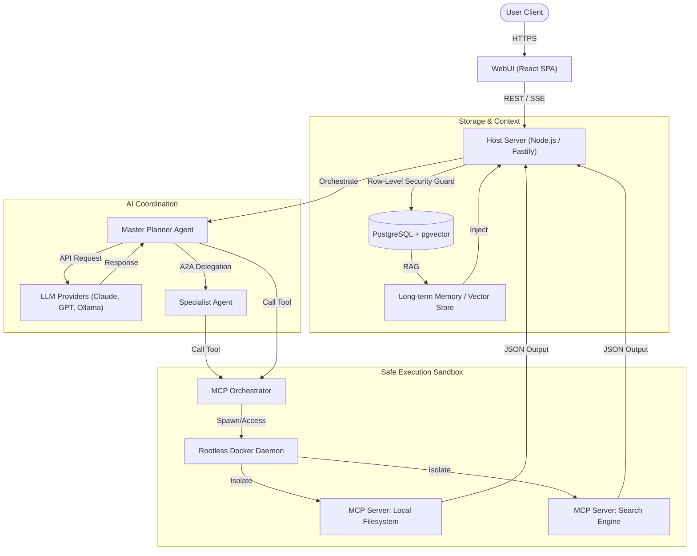
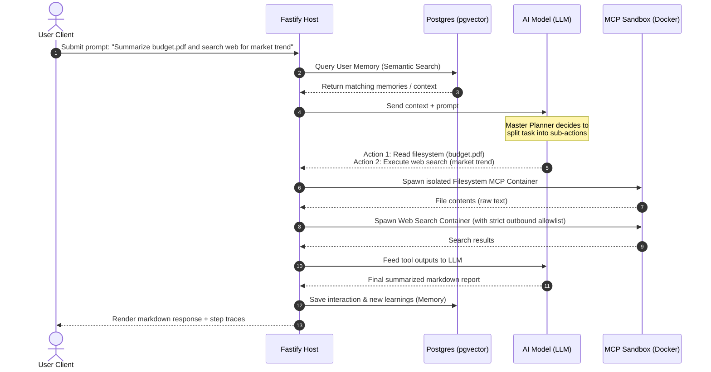

# Aster

### **Your Data. Your AI. Your Rules.**

**Aster** is a self-hosted, enterprise-ready, open-source AI agent platform. Run powerful AI agents, orchestrate complex multi-agent workflows, and securely connect models to your local and external tools - entirely on your own infrastructure, without compromising data privacy or compliance.

**[GitHub Repository](https://github.com/daksh777f/Aster)** · [Documentation](./docs/README.md)

[](./LICENSE)
[](./LICENSE-COMMERCIAL.md)


---

## The Problem & The Solution

### **The Problem: The Cloud Privacy Dilemma**
Every time your team copies a spreadsheet, a contract, or a proprietary document into a public cloud AI tool (like ChatGPT or Claude), **your data leaves your company walls**. 
* **Data Privacy:** Your intellectual property is processed on external servers and may be used for model training.
* **Compliance Risks:** Uploading customer data to the cloud violates strict compliance regulations like GDPR, HIPAA, and CCPA.
* **Security Exposure:** Running custom scripts or integrations (plugins) on your internal networks directly linked to the LLM exposes you to prompt injection and unauthorized command execution.

### **The Solution: Aster**
Aster is a self-hosted platform that runs **entirely on your own hardware or private cloud**. It keeps the power of state-of-the-art AI while ensuring your data never exits your secure boundary. 

Through its **MCP-native architecture**, Aster isolates every tool and script in separate, restricted Docker containers, making it the most secure way to connect AI models to your databases, local filesystem, and internal APIs.

### **Why Aster is Better than Alternatives**

| Feature / Metric | Public Cloud AIs (e.g., ChatGPT Team) | General AI Toolkits (e.g., Flowise, Langflow) | **Aster (Self-Hosted)** |
|---|---|---|---|
| **Data Sovereignty** | No (Data sent to third-party cloud) | Depends on hosting |  **True Sovereignty.** Runs on-premise. |
| **Tool Execution Security** | None (Running arbitrary code is unsafe) | Process runs directly on host machine |  **Strict Sandbox.** Rootless Docker containers with egress allowlists. |
| **Privacy Isolation** | No (Admins can see user logs) | Basic or no database-level tenant isolation |  **Strict Privacy.** Row-Level Security (RLS); even admins cannot read private chats. |
| **Agent Autonomy** | Limited to custom GPT instructions | Linear pipelines |  **A2A Coordination.** Master Planner delegates subtasks to specialist sub-agents up to 5 levels deep. |
| **Capabilities Extension** | Locked to app store or plugins | Complex coding required |  **Skill Creator.** Generates and validates new capabilities dynamically using natural language. |

---

## Architecture & Data Workflow

Aster divides processing, execution, and data storage into distinct layers. 

* The **Frontend WebUI** renders the chat and designer.
* The **Backend Host** coordinates agent logic, databases, and cron schedules.
* The **Orchestrator** manages short-lived, sandboxed Docker containers running MCP (Model Context Protocol) servers.

### **System Architecture**



### **Data Flow: Processing a Request**



---

## Core Features

* **Visual Chain Designer:** Design multi-agent workflows graphically without writing a line of code.
* **Agent-to-Agent Delegation (A2A):** Break down large problems. A planning agent orchestrates and assigns sub-problems to specialist agents (e.g. database specialist, coder, researcher).
* **Docker-Isolated MCP Tools:** Native support for the Model Context Protocol. MCP servers are automatically run in rootless Docker containers with strict CPU, memory, and network allowlist protections.
* **Long-Term Vector Memory (RAG):** Auto-indexing of conversation context and text documents into Postgres `pgvector` tables, split cleanly by namespace and protected by database-level Row Level Security.
* **Agent Skills (Open Standard):** Compatible with the `agentskills.io` standard. Write reusable scripts, or use the **built-in Skill Creator** to construct, lint, and validate new skills interactively directly inside the chat.
* **Automated Cron Scheduling:** Run agent tasks or chains on a schedule (e.g. daily reports, system health checks) with optional chat continuation.
* **Strict Privacy Policy:** Hardcoded database separation ensures that administrators can never view user chats or modify private memory without explicit user opt-in.

---

## Technical Stack

* **Frontend:** React, TypeScript, Vite, Tailwind CSS, shadcn/ui
* **Backend:** Node.js, Fastify, TypeScript
* **Database:** PostgreSQL with `pgvector` extension
* **Database Migrations:** Flyway (Community Edition)
* **Containerization:** Docker, Docker Compose (configured for rootless deployments)
* **Protocols:** Model Context Protocol (MCP), SSE (Server-Sent Events)

---

## System Requirements

| Component | Minimum | Recommended | Notes |
|---|---|---|---|
| **Operating System** | Linux / macOS | Ubuntu 22.04+ / macOS | Windows supported via WSL2 |
| **Docker** | Engine 24+ | Engine 26+ | Rootless mode strongly recommended |
| **Docker Compose** | v2.20+ | v2.26+ | Run as `docker compose` (not legacy `docker-compose`) |
| **RAM** | 2 GB | 4 GB+ | Increase if running local embedding models |
| **Disk Space** | 5 GB free | 10 GB+ | Required for Docker images and caching |
| **Network Tools** | openssl, curl, jq | latest | Utilized by installer scripts |

*Note: At least one AI Provider API Key (e.g., Anthropic, OpenAI, or a local Ollama instance) is required to operate.*

---

## Quick Start

### **1. Guided Installation (Recommended)**
Run the interactive setup script on your target server. It configures the Docker environment, generates secure database credentials and session secrets, sets up database migrations, and prompts you to create the initial admin account:

```bash
curl -fsSL https://raw.githubusercontent.com/daksh777f/Aster/main/scripts/install.sh | bash
```

### **2. Manual Docker Compose Setup**
To customize your setup manually, clone the repository, copy the example environment file, customize your secrets, and launch the stack:

```bash
# Clone the repository
git clone https://github.com/daksh777f/Aster.git
cd Aster

# Set up environment variables
cp .env.example .env

# Edit .env and change FLYWAY_PASSWORD, ASTER_APP_PASSWORD, and session secrets
# Start the containers
docker compose up -d
```

Once running, visit **`http://localhost:5173`** in your browser to log in and start using Aster.

---

## Documentation Reference

For step-by-step guides, configuration settings, and administrator consoles, please refer to the files in the local [docs](./docs/README.md) directory:

| Topic | English Manual |
|---|---|
| Introduction | [EN](./docs/en/getting-started/01_introduction.md) |
| Installation Guide | [EN](./docs/en/getting-started/02_installation.md) |
| Environment Variables Reference | [EN](./docs/en/configuration/01_environment_variables.md) |
| Agent Concepts | [EN](./docs/en/admin/agents/01_concept.md) |
| Custom Agent Skills | [EN](./docs/en/admin/skills/01_concept.md) |
| Visual Chain Engine | [EN](./docs/en/admin/chains/01_concept.md) |
| Vector Memory & RAG | [EN](./docs/en/admin/memory_audit/01_architecture.md) |
| Security Architecture | [EN](./docs/en/security/01_security_concept.md) |
| Cron Automations | [EN](./docs/en/automation/01_overview.md) |
| API Endpoints | [EN](./docs/en/api/01_api-ref.md) |

---

## License & Contact

Aster is dual-licensed:
1. **Open Source:** [GNU Affero General Public License v3.0](./LICENSE) - free for personal use, self-hosted deployments, and open-source projects.
2. **Commercial:** [Commercial License](./LICENSE-COMMERCIAL.md) - for organizations wishing to use Aster without AGPL copyleft obligations (e.g. inside proprietary products or as white-label offerings). 

For licensing inquiries or community help:
* **Repository:** https://github.com/daksh777f/Aster
---

Copyright (c) 2026 Daksh Goel - https://github.com/daksh777f/. All rights reserved.
